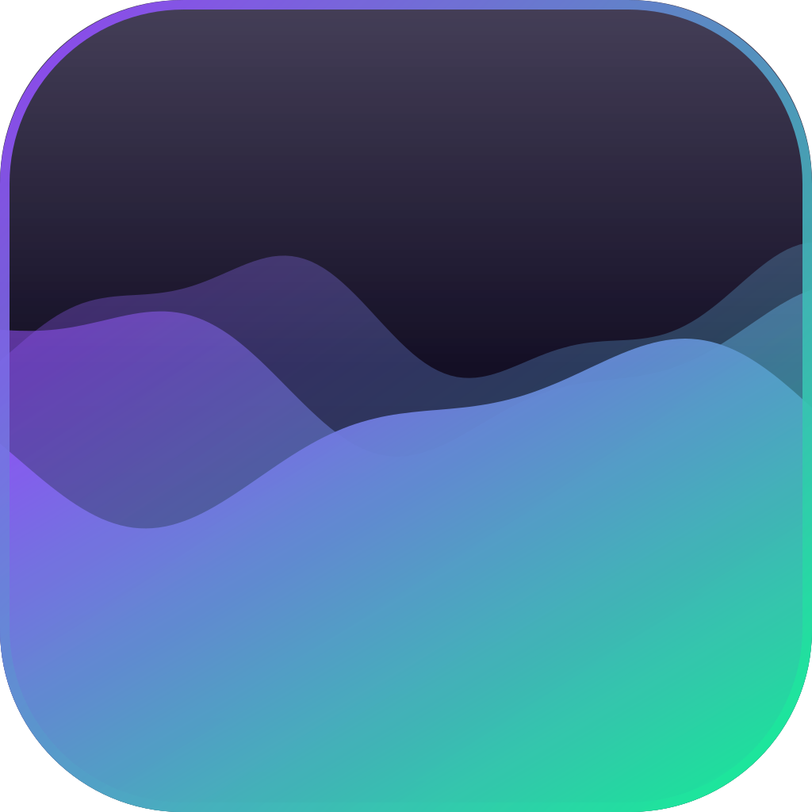

<p align="center">
  
</p>

<h1 align="center">WaveDock</h1>
<p align="center"><b>Панель задач Windows, которая танцует под твою музыку 🌊</b></p>

<p align="center">
  <a href="../../releases/latest"><b>⬇️ Скачать последнюю версию</b></a>
</p>

---

Маленький квадрат с живыми волнами прямо на панели задач Windows 10/11.
Волны прыгают в такт тому, что у тебя играет, а по клику открывается красивый плеер.

## ✨ Возможности

- 🎵 **Волны реагируют на звук** в реальном времени
- ▶️ **Плеер в один клик** — обложка, название, перемотка, громкость
- 📝 **Текст песни**, синхронно с музыкой (через [lrclib.net](https://lrclib.net))
- 🔔 **Плашка «Сейчас играет»** при смене трека
- 🎮 **Статус в Discord** — «Слушает WaveDock» с треком и обложкой
- ⌨️ **Глобальные горячие клавиши** — работают даже в играх
- 🎨 **Полная кастомизация** — размер, цвета, волны, анимации
- 🙈 Сам прячется в играх и полноэкранном видео

Работает со **Spotify, Яндекс Музыкой, YouTube / VK / SoundCloud в браузере, Медиаплеером Windows, AIMP** и любым плеером, который показывает трек в системной плашке громкости.

## 🚀 Установка

1. Скачай `WaveDock_vX.X.zip` со страницы [Releases](../../releases/latest).
2. Распакуй и запусти `WaveDock.exe`. Ничего ставить не нужно.
3. Если Windows покажет «Система Windows защитила ваш компьютер» — нажми **Подробнее → Выполнить в любом случае** (у программы нет платной цифровой подписи).

## 🎛 Управление

| Действие | Что делает |
|---|---|
| Клик по квадрату | открыть / закрыть плеер |
| Средняя кнопка | пауза |
| Колесо мыши | следующий / предыдущий трек |
| Ctrl + колесо | громкость |
| Перетащить квадрат | сдвинуть по панели задач |
| Правый клик | настройки, автозапуск, выход |

**Горячие клавиши:** `Ctrl+Alt+Пробел` (или `P`) — пауза · `Ctrl+Alt+→/←` — треки · `Ctrl+Alt+↑/↓` — громкость · `Ctrl+Alt+L` — текст песни.

## 🛠 Сборка из исходников

Нужен [.NET 8 SDK](https://dotnet.microsoft.com/download/dotnet/8.0).

```bat
setup.bat      :: собрать и запустить (для разработки)
release.bat    :: собрать один exe со всем внутри + zip для раздачи
```

Стек: C# · WPF · .NET 8 · Windows Media Control API · NAudio (WASAPI loopback) · Discord IPC.

---
<p align="center">Сделано с ❤️ · если нравится — поставь ⭐</p>
